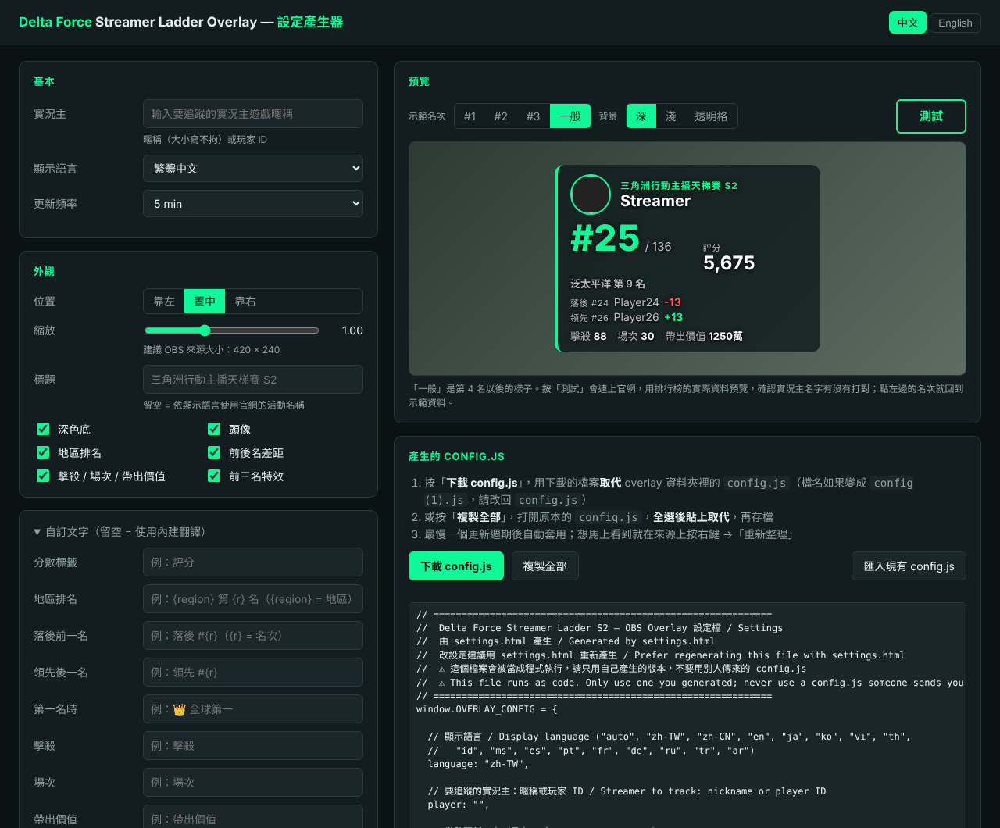
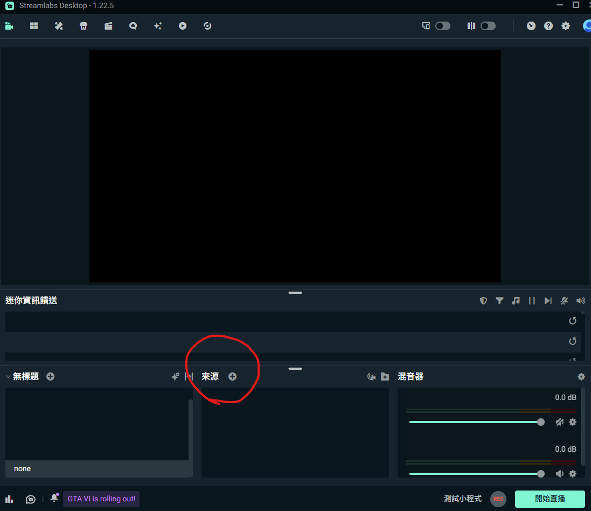
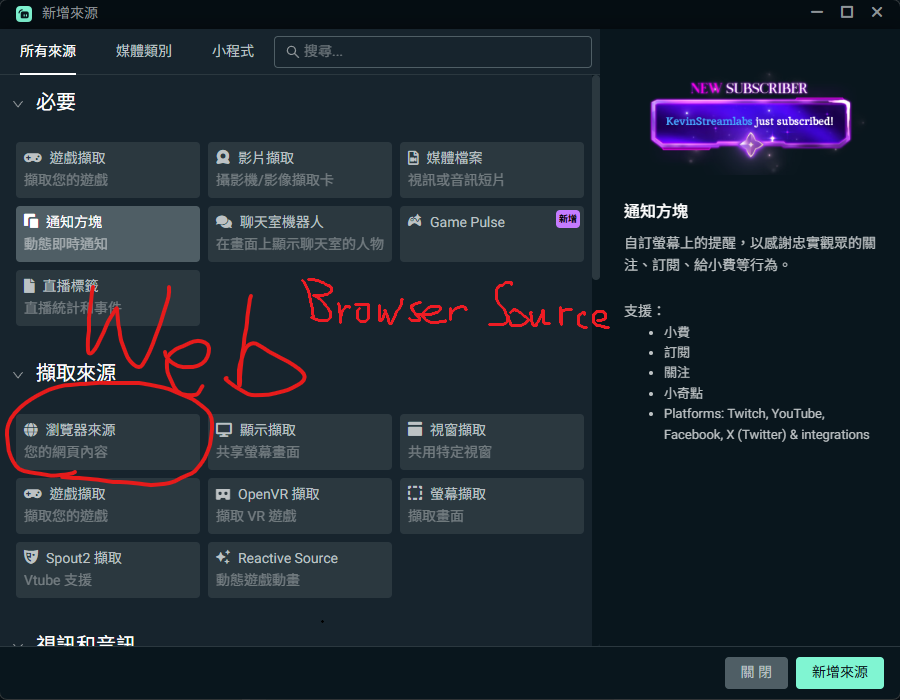
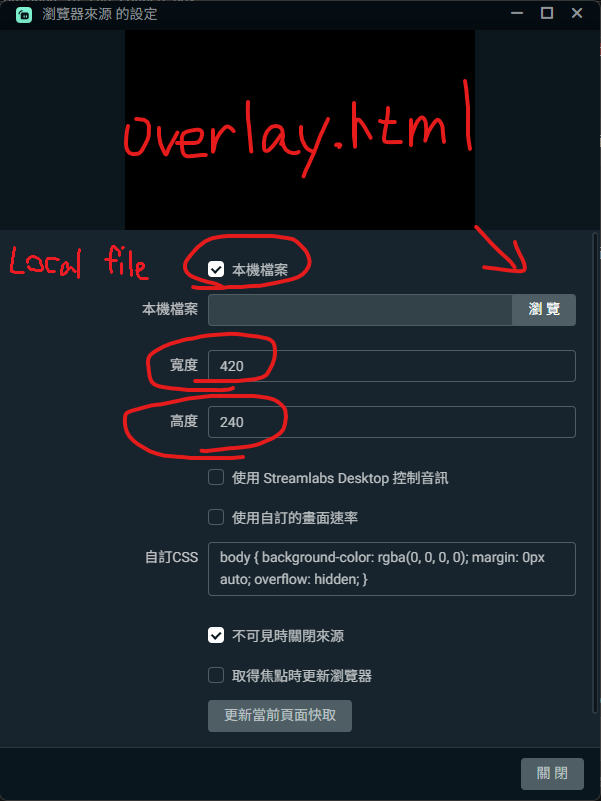

# Delta Force Streamer Ladder S2 — OBS Rank Overlay

[English](#english) | [繁體中文](#繁體中文)

---

## English

A lightweight OBS browser-source overlay that shows a streamer's live position on the
**Delta Force Streamer Ladder S2** global leaderboard: rank, rating, and the point gap to the players
directly above and below.

Data comes straight from the same ranking endpoint the official event page uses (the ladder itself
refreshes every minute). No server, no install, no login. It's just one HTML file plus a config file.

### Features

- Global rank, total players, and rating, in Delta Force green
- Regional rank, using the official region names
- Gold / silver / bronze rank styling with medals for the top 3
- Point gap to the player above (how far behind) and below (how far ahead)
- ▲ / ▼ rank-change indicator with a flash animation when the rank moves
- Kills, matches, and extracted value
- Transparent background, auto-centered in the source box
- Visual settings page with live preview that generates the config file for you. No code editing needed
- Settings apply automatically without restarting OBS
- **16 languages**, the same set as the official event page, with locale-aware number formatting
  and right-to-left layout for Arabic

### Files

| File | Purpose |
|---|---|
| `overlay.html` | The overlay. This is what OBS loads |
| `settings.html` | **Settings page**. Open it in your browser to generate `config.js` |
| `config.js` | Settings file read by the overlay |
| `README.md` | Documentation (English / Chinese) |
| `LICENSE` | MIT License |

### Step 1 — Set it up with the settings page

1. Double-click `settings.html` to open it in your browser
2. Pick your options. The preview on the right updates live (switch between #1 / #2 / #3 / **Other**
   to see each style, or click **Test** to check the streamer name against the real ladder)
3. Click **Download config.js** and replace the `config.js` in the overlay folder with it
   (or **Copy all** and paste over the whole content of your `config.js`)



Use **Import existing config.js** to load your current settings and tweak them instead of starting over.
Everything the page writes is stored as plain data, so quotes or symbols in your text can't break the file.

### Step 2 — Add it to OBS / Streamlabs Desktop

The screenshots below are from Streamlabs Desktop. OBS works the same way.

**1.** Click **+** next to **Sources**



**2.** Choose **Browser Source**



**3.** Tick **Local file**, click **Browse** and select `overlay.html`, then set width `420` and height `240`



**4.** Close the window and drag the overlay into place

The card is centered inside the source box, so it stays aligned even if the box is larger than the card.
If you set **Scale** above 1, enlarge the source box too (the settings page shows the recommended size).

### Changing settings later

Open `settings.html` again (use **Import existing config.js** to start from your current settings),
generate a new file, and replace `config.js`. **No need to restart OBS.** The overlay re-reads `config.js` on every refresh (within 5 minutes by default).
To apply changes immediately, right-click the browser source → **Refresh**.

### Advanced: editing `config.js` by hand

You can also edit `config.js` directly in a text editor. All settings:

| Setting | Default | Description |
|---|---|---|
| `language` | `"zh-TW"` | Display language. See [Languages](#languages) |
| `player` | `""` | Streamer to track: nickname (case-insensitive) or player ID. **Required** |
| `interval` | `300` | Refresh interval in seconds (minimum 30; the ladder updates every minute) |
| `align` | `"center"` | `"left"` / `"center"` / `"right"` |
| `scale` | `1` | Overall size, e.g. `1.3` for 30% larger |
| `background` | `true` | `false` = fully transparent, text only |
| `showAvatar` | `true` | Show the avatar |
| `showStats` | `true` | Show kills / matches / extracted value |
| `showGaps` | `true` | Show the point gap to the players above and below |
| `showRegion` | `true` | Show the regional rank (hidden if the streamer has no region) |
| `topEffects` | `true` | Gold / silver / bronze styling and medals for the top 3 |
| `title` | `""` | Title. Empty = the official event name in the display language |
| `text` | `{}` | Override individual labels, e.g. `{ value: "Loot" }` |

Keep text values in `"double quotes"` and don't delete the trailing commas. If the file has a
mistake, the card shows a red notice and keeps the last working settings (or the defaults if it
has never loaded correctly), so a typo never breaks the overlay.

**Why `.js` and not `.txt`?** When OBS opens a local HTML file, browser security rules stop the page
from reading a `.txt` file in the same folder, but loading a `.js` file is allowed.

#### URL parameters (optional)

Any setting can also be overridden in the source URL. Untick **Local file** and use, for example:

```
file:///C:/path/to/overlay.html?lang=en&player=YourName&scale=1.3&bg=0
```

Supported: `lang`, `player`, `interval`, `align`, `scale`, `bg`, `avatar`, `stats`, `gaps`.

### Languages

Same 16 languages as the official event page:

| Code | Language | Code | Language |
|---|---|---|---|
| `zh-TW` | 繁體中文 | `ms` | Bahasa Melayu |
| `zh-CN` | 简体中文 | `es` | Español |
| `en` | English | `pt` | Português |
| `ja` | 日本語 | `fr` | Français |
| `ko` | 한국어 | `de` | Deutsch |
| `vi` | Tiếng Việt | `ru` | Русский |
| `th` | ไทย | `tr` | Türkçe |
| `id` | Bahasa Indonesia | `ar` | العربية (right-to-left) |

- `"auto"` follows the computer / OBS language and falls back to English.
- Terms match the official event page where it reads naturally (e.g. 帶出價值 / 持ち帰り価値 / 반출 가치),
  with a few literal official translations replaced by what players actually say.
- Numbers follow the language: `1,250萬` (zh-TW), `1250万` (ja), `1250만` (ko), `12.5M` (en), `12,5 Mio.` (de).
- Each language uses a matching regional font, so shared CJK characters render in the correct
  Chinese, Japanese, or Korean glyph style.
- Streamer nicknames are shown as-is.
- To reword a label, add it to `text` in `config.js`. Keys: `rating`, `regionRank`, `above`, `below`, `first`,
  `kills`, `matches`, `value` (`{r}` is replaced with the rank, `{region}` with the region name).

### Reading the card

- **#25 / 136**: global rank / players on the ladder
- **PAN-PACIFIC #9**: rank within the streamer's region (the top 20 of each region also win prizes)
- **▲2 / ▼1**: the most recent rank change. It stays on screen until the rank moves again
- **Top 3**: the rank turns gold / silver / bronze with a medal (🥇🥈🥉); #1 also gets a shine animation
- **To #24 … -13**: points needed to catch the player above
- **Ahead of #26 … +18**: lead over the player below
- **±0**: tied on points

### Troubleshooting

- **Red "Update failed" notice**: the official endpoint didn't respond (it gives up after 15 seconds).
  The last data stays on screen and the overlay retries automatically.
- **Red "not found" notice**: `player` in `config.js` is misspelled, or that streamer isn't on the ladder.
- **Nothing loads at all**: open `overlay.html` in Chrome and check the console (F12). If the event page
  changed its endpoint or event ID, update `iChartId` / `sIdeToken` / `instanceid` in `overlay.html`.

### Disclaimer

**Security note:** `config.js` is executed as JavaScript inside OBS / Streamlabs. Only use files from this
repository or ones you generated with `settings.html`, and never replace your `config.js` with one someone else sends you. A malicious config file
could run any code inside your streaming software.

This is an unofficial fan-made tool. It is not affiliated with Delta Force or its developers or publishers.
Ranking data comes from an endpoint the official event page uses publicly, which may change at any time
and break this tool. Please keep the refresh interval reasonable to avoid putting unnecessary load on
the official servers.


### License

[MIT](LICENSE) © 2026 derder2000. You're free to use, modify, and share it; just keep the copyright notice.

---

## 繁體中文

在直播畫面上即時顯示實況主在 Streamer Ladder S2 全球榜的名次、分數、和前後名的差距。
資料直接來自官方活動頁用的排名介面（官方每分鐘更新）。

### 檔案

| 檔案 | 用途 |
|---|---|
| `overlay.html` | overlay 本體，OBS 載入這個 |
| `settings.html` | **設定頁**，用瀏覽器打開，產生 `config.js` |
| `config.js` | overlay 讀取的設定檔 |
| `README.md` | 說明文件（英文 / 中文） |
| `LICENSE` | MIT 授權條款 |

### 第 1 步：用設定頁設定

1. 雙擊 `settings.html`，用瀏覽器打開
2. 選好想要的設定，右邊會即時預覽（可以切換 #1 / #2 / #3 /「一般」看不同名次的樣子，或按「**測試**」連上官網用實際資料確認實況主名字有沒有打對）
3. 按「**下載 config.js**」，用下載的檔案取代 overlay 資料夾裡的 `config.js`
   （或按「**複製全部**」，打開原本的 `config.js` 全選後貼上取代，再存檔）


想從目前的設定接著改，可以按「**匯入現有 config.js**」。設定頁產生的內容全部是純資料，文字裡有引號或符號也不會讓檔案壞掉。

### 第 2 步：放進 OBS / Streamlabs Desktop

以下截圖是 Streamlabs Desktop，OBS 的步驟相同。

**1.** 按「來源」旁邊的 **＋**


**2.** 選「**瀏覽器來源**」


**3.** 勾選「**本機檔案**」，按「瀏覽」選 `overlay.html`，寬度填 `420`、高度填 `240`


**4.** 關閉視窗，把 overlay 拖到想放的位置

卡片預設會在來源框裡**置中**，所以來源框比卡片大也不會歪。
如果「縮放」設定大於 1，來源框的寬高也要跟著調大（設定頁會顯示建議的大小）。

### 之後要改設定

再打開 `settings.html`（可以先按「匯入現有 config.js」從目前的設定接著改），產生新的檔案取代 `config.js` 即可。
**不用重開 OBS**，overlay 下一次更新時（預設 5 分鐘內）就會自動套用。
想馬上看到效果：在瀏覽器來源上按右鍵 →「重新整理」。

### 進階：手動編輯 config.js

也可以直接用記事本改 `config.js`，所有設定如下：

| 設定 | 預設 | 說明 |
|---|---|---|
| `language` | `"zh-TW"` | 顯示語言，見下方「多語系」 |
| `player` | `""` | 追蹤的實況主暱稱（大小寫不拘），也可以填玩家 ID。**必填** |
| `interval` | `300` | 幾秒更新一次（最少 30，官方每分鐘更新） |
| `align` | `"center"` | `"left"` / `"center"` / `"right"` |
| `scale` | `1` | 整體縮放，例如 `1.3` |
| `background` | `true` | `false` = 完全透明，只剩文字 |
| `showAvatar` | `true` | 顯示頭像 |
| `showStats` | `true` | 顯示擊殺／場次／出貨 |
| `showGaps` | `true` | 顯示和前後名的差距 |
| `showRegion` | `true` | 顯示地區排名（實況主沒有地區資料時自動隱藏） |
| `topEffects` | `true` | 前三名特效：金 / 銀 / 銅名次與獎牌 |
| `title` | `""` | 標題，留空 = 依顯示語言使用官網的活動名稱 |
| `text` | `{}` | 自訂某幾個字的說法，例如 `{ value: "出貨" }` |

### 多語系

支援和官方活動頁相同的 16 種語言：

`zh-TW` 繁體中文、`zh-CN` 简体中文、`en` English、`ja` 日本語、`ko` 한국어、`vi` Tiếng Việt、`th` ไทย、
`id` Bahasa Indonesia、`ms` Bahasa Melayu、`es` Español、`pt` Português、`fr` Français、`de` Deutsch、
`ru` Русский、`tr` Türkçe、`ar` العربية（由右到左顯示）

- `"auto"` 會跟著電腦 / OBS 的語言，找不到對應語言時用英文。
- 數字格式也會跟著語言走：繁中「1,250萬」、日文「1250万」、韓文「1250만」、英文「12.5M」、德文「12,5 Mio.」。
- 每個語言會用該地區的字型，漢字在中、日、韓文下各自顯示正確字形。
- 實況主暱稱照原樣顯示，不翻譯。
- 想改某個字（例如把「帶出價值」改成「出貨」）：在 `config.js` 寫 `text: { value: "出貨" },`。

注意：文字要用 `"雙引號"` 包起來，每行最後的逗號不要刪。改壞的話卡片會顯示紅字提示，並繼續沿用上一次正確的設定（從來沒讀對過的話就用預設值），打錯字也不會讓 overlay 壞掉。

為什麼不用 .txt：OBS 開本機網頁時，瀏覽器的安全限制不讓網頁讀同資料夾的 .txt，但可以載入 .js 檔。

### 畫面說明

- **#25 / 136**：全球名次 / 榜上總人數
- **泛太平洋 第 9 名**：在自己地區裡的名次（各地區前 20 名也有獎勵）
- **▲2 / ▼1**：最近一次的名次變動，會一直顯示到名次再次變動為止（變動時卡片會閃一下）
- **前三名**：名次變成金 / 銀 / 銅色並加上獎牌（🥇🥈🥉），第 1 名還有光澤動畫
- **落後 #24 … -13**：離前一名還差幾分
- **領先 #26 … +18**：贏後一名幾分
- **±0**：同分

### 出問題時

- 紅字「更新失敗」：官方介面暫時沒回應（等 15 秒沒回應就放棄），會保留上一次的資料並自動重試。
- 紅字「榜上找不到…」：`config.js` 的 `player` 打錯，或那個人不在榜上。
- 官方如果改了介面或活動 ID，要更新 `overlay.html` 裡的 `iChartId` / `sIdeToken` / `instanceid`。

### 聲明

**安全提醒：**`config.js` 會在 OBS / Streamlabs 裡被當成 JavaScript 執行。請只使用本專案 GitHub 上的檔案或自己用 `settings.html` 產生的設定，
不要用別人傳來的 `config.js` 覆蓋自己的。來路不明的設定檔可能在你的直播軟體裡執行任意程式。

本專案為粉絲自製的非官方工具，與 Delta Force 及其開發、營運商無任何關聯。
排名資料來自官方活動頁公開使用的介面，官方隨時可能變更，屆時本工具可能失效。
請勿把更新間隔設得過短，以免對官方伺服器造成不必要的負擔。

### 授權

[MIT](LICENSE) © 2026 derder2000。可以自由使用、修改、分享，只要保留原本的版權聲明即可。
